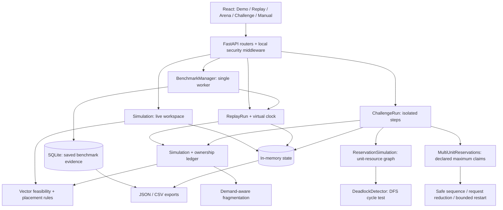

# Fragmentation-aware GPU allocator — design

## 1. Problem analysis

GPU requests are vectors: compute, memory, and accelerator units must fit on one compatible node. Free units summed across nodes are not necessarily usable by a job. On three (8,16) GPUs, distributing three (2,4) jobs leaves (18,36) free across the cluster, but no node can satisfy a waiting (8,16) request. This is the Fragmentation Trap. Packing the small jobs onto one node preserves a complete node for the large request.

Capacity balance is not fragmentation. The legacy max-minus-min utilization measure remains available as resource imbalance. New metrics distinguish largest free blocks, external fragmentation, demand-dependent stranded capacity, and feasible jobs blocked by distribution.

Circular waiting requires partial acquisition. The main scheduler acquires an entire vector atomically and eliminates hold-and-wait. A separate reservation engine demonstrates actual circular wait, Banker's avoidance, and multi-unit detection/recovery. Incompatible node types are rejected before admission. Aging addresses priority starvation without changing the six existing queue policies.

## 2. Architecture and data flow



The server uses one process. Locks serialize state transitions; they are not atomic CAS instructions. Replay and challenges never mutate the manual cluster. Benchmark archives survive restart; live sessions do not. The production build is served from `/studio/` on the same origin, with no runtime CDN or network dependency.

## 3. OS concepts mapped to code

| OS concept | Actual implementation |
| --- | --- |
| Resource allocation | `backend/app/algorithms/allocation.py`: `GPUResourceManager.can_allocate`, `allocate`, `release`; `Simulation._allocations` records ownership. |
| Fragmentation | `backend/app/algorithms/demand_fragmentation.py`: `measure`; `backend/app/algorithms/placement.py`: `packing_key`, `alignment_score`. |
| Scheduling | `backend/app/services/simulation.py`: `sort_jobs_by_policy`, `allocate_on_best_gpu`, `retry_waiting_jobs`; `ReplayRun._process_timestamp` completes jobs before arrivals and dispatch. |
| Preemption | `Simulation.victim_enables_allocation`, `try_preempt_for_job`; `Job` retains executed work across interruptions. |
| Deadlock prevention | Main `Simulation.get_deadlock_status` retains `NOT_APPLICABLE` and reports `HOLD_AND_WAIT_ELIMINATED`. |
| Deadlock avoidance | `backend/app/services/banker.py`: `MultiUnitReservations.safe_sequence` and `_can_grant`. |
| Deadlock detection/recovery | Unit engine `ReservationSimulation.cycles` uses `DeadlockDetector`; multi-unit `deadlocked` uses current-request reduction; `recover` releases and requeues a victim. |
| Fairness | `Simulation.sort_jobs_by_policy`: `PRIORITY_AGING`; `benchmark.trial_metrics`: observed maximum wait, starvation and slowdown equality. |
| Lifecycle/accounting | `Job._transition`; `Simulation.cancel_job`, `complete_job`, `assert_resource_invariants`; `InvariantError` survives Python `-O`. |

## 4. Algorithms and data structures

### Placement

The historical default remains **NORMALIZED** so existing baseline behavior and the prepared reference remain reproducible. BEST_FIT_PACKING is an opt-in correction for the fragmentation trap. FIRST_FIT and MEMORY_BEST_FIT remain available; ALIGNMENT is an experimental ablation, not a novelty claim or new default.

```text
eligible = compatible nodes whose available vector covers the request
for node in eligible:
    leftover[d] = (available[d] - request[d]) / total[d], for total[d] > 0
BEST_FIT_PACKING selects min(max(leftover), sum(leftover), node ID)
FIRST_FIT selects the first eligible node in configured order
MEMORY_BEST_FIT minimizes remaining memory, then historical score and ID
ALIGNMENT maximizes 0.6 * cosine(normalized request, normalized availability)
          - 0.3 * stranded-leftover penalty, then node ID
```

Alignment weights are configurable, nonnegative and sum to at most one. Its penalty uses currently admitted waiting demand only; it cannot predict future jobs. Placement choice and candidate components are recorded before mutation.

### Fragmentation

```text
for each resource dimension:
    total_free = sum(node.free)
    largest = max(node.free)
    largest_free_block_ratio = largest / total_free, or null if no free units
    external_fragmentation = 1 - ratio, or 0 if no free units
    stranded = free units on nodes where no feasible waiting request fits
    stranded_capacity = stranded / total_free, or 0 without free/waiting demand
blocked_by_fragmentation = feasible waiting requests which fit summed compatible
                          free vectors but fit no individual compatible node
```

Overall ratios are the mean across dimensions with free units. Infeasible requests are excluded from demand metrics. These concentration ratios are descriptive: low external fragmentation alone does not prove better service. Replay integrates piecewise-constant metrics using rational resource-microseconds, making polling frequency irrelevant. Arena reports time averages and paired results on identical traces.

### Avoidance and detection

```text
SafeSequence(candidate allocation):
    Work = total - sum(allocations)
    repeatedly find an unfinished process with (maximum - allocation) <= Work
    simulate its completion: Work += its allocation
    safe iff every unfinished process can be removed

AVOIDANCE grants a free request only if SafeSequence exists after the grant
NAIVE grants whenever free, even if the resulting state is unsafe
MultiUnitDeadlocked:
    Work = available
    consider only processes which hold resources
    repeatedly remove a process whose current pending request fits Work
    add its holdings to Work; remaining holders are deadlocked
```

A wait-for cycle is sufficient for the unit-resource fixture, not for general multiple-instance resources. Recovery selects a deadlocked holder, either youngest or lowest `(estimated work + held units, youngest tie)`. It releases holdings, drains pending grants and restarts the victim with zero holdings and a full-claim request. After its restart limit, the victim is protected; if no victim remains, `RECOVERY_BLOCKED` requires operator intervention. Work counters are supplied simulation estimates, not GPU telemetry.

### Aging

```text
effective_priority = base_priority + aging_rate * accumulated_queued_wait
dispatch feasible waiting jobs by decreasing effective_priority, then FIFO
```

Rate is bounded to 0.01–100 priority units per second. This policy does not preempt running work. It protects old feasible demand against new priority arrivals under the measured balanced stream; it does not promise universal bounded waiting on overloaded or incompatible workloads. Jain's slowdown index measures equality among completed jobs and can be high even when all jobs wait a long time.

## 5. Walkthrough and edge cases

1. **C1:** N1=(4,8). J1=(2,6) runs; J2=(3,3) waits. Release J1 and J2 starts, leaving (1,5).
2. **C2:** Cancel J1 once, cancel again, cancel J99. The second release is a no-op; unknown ID holds nothing. Capacity remains (4,8).
3. **C3:** First fit leaves J2 waiting and free (0,4); memory best fit leaves J3 waiting and free (4,0). Both run two jobs and achieve 83.33% mean compute/memory utilization. Total demand (16,16) exceeds capacity (12,12).
4. **C4 original:** A holds G1 and requests G2; B holds G2 and requests G1. Abort younger B; release G2 and grant A. Complete A and restore both resources. The original fixture is unchanged.
5. **C5:** Type Z is rejected; type X runs only on N1, type Y only on N2. Rejected requests do not consume IDs or block feasible work. A supported type with impossible capacity is rejected too.
6. **Fragmentation Trap:** choose FCFS, the preset and NORMALIZED placement, then advance to t=1. The whole-GPU job waits with 75% of compute/memory free. BEST_FIT_PACKING starts it at t=1. Makespan improves 28→20 seconds; p95 wait 19→0 seconds. Export an Arena placement comparison.
7. **Multi-unit C4:** select each mode on capacities (2 Compute,2 Memory); both processes declare maximum (2,2). NAIVE ends with A/B deadlocked. AVOIDANCE postpones B's unsafe reservation, completes A, then completes B. DETECT_RECOVER aborts/restarts B once, grants A, completes A and then B.
8. **Fairness stream:** 31 batches of three full-GPU priority-5 jobs arrive every 10 seconds alongside a priority-1 job. PRIORITY makes it wait 310 seconds; aging rate 1 starts it at 10 seconds. Both makespans are 320 seconds. Aging raises p95 wait from 0 to 10 seconds while reducing the maximum to 10 seconds; starvation at threshold 30 falls from 1.06383% to 0%.

The API also covers repeat completion, invalid claims, terminal no-ops, unknown resources, bounded sessions, invalid JSON, maximum job limits, and reset without reusing prior job IDs. Tests include 200 seeded avoidance sequences and an optimized-Python invariant subprocess.

## 6. Trade-offs, limitations and future work

Resources and durations are simulated. Checkpoint and recovery time in GPU replay are assumed zero. No real GPU, topology, gang/multi-GPU job or tenant scheduler exists. All jobs in the main scheduler remain single-node. Partial acquisition is demonstrated in a separate generic reservation engine, not silently substituted into the GPU allocator.

Packing preserves large contiguous free vectors but can be worse for a different workload. Alignment is an ablation; it is not an implementation of Tetris, DRF or another research system. Fairness and utilization are separate objectives. C3's 100% packing requires deferring or evicting J1; strict no-equal-priority eviction conflicts with its supplied equal-priority trace. Repack and multi-victim defragmentation are deferred until their fairness/cost rules are specified and tested.

The local workspace is capped at 5,000 retained jobs; replay and experiment budgets are bounded separately. JSON job creation is preferred; legacy query inputs remain for compatibility. Browser origins are restricted; a shared bearer token is optional. This is not production authentication, isolation or authorization. SQLite is local and one benchmark worker serializes experiments. Scale-out requires durable distributed ownership and proper identity controls.

## 7. Claims we make / do not make

We demonstrate real deterministic state transitions, resource conservation, a measured naive-placement failure, progress-preserving preemption, declared-claim avoidance, reduction-based multi-unit recovery, and a measured aging trade-off. Prepared examples are labeled. Existing tests stay intact.

We do not claim global novelty, universal superiority, real GPU performance, production security, deadlock in the atomic scheduler, or a fragmentation win for the original two-column C3. Single fixed traces do not provide independent statistical replication; duplicate seeds are collapsed and confidence intervals remain unavailable.

Research context was checked against primary sources: [Dijkstra's mathematics of Banker's Algorithm](https://www.cs.utexas.edu/~EWD/transcriptions/EWD06xx/EWD623.html), [Grandl et al., Multi-resource Packing / Tetris, SIGCOMM 2014](https://www.microsoft.com/en-us/research/publication/multi-resource-packing-for-cluster-schedulers/), and [Ghodsi et al., Dominant Resource Fairness, NSDI 2011](https://www.usenix.org/conference/nsdi11/dominant-resource-fairness-fair-allocation-multiple-resource-types). These establish prior work; this prototype does not implement DRF or claim to reproduce Tetris.
